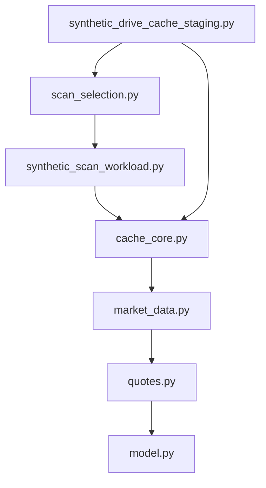
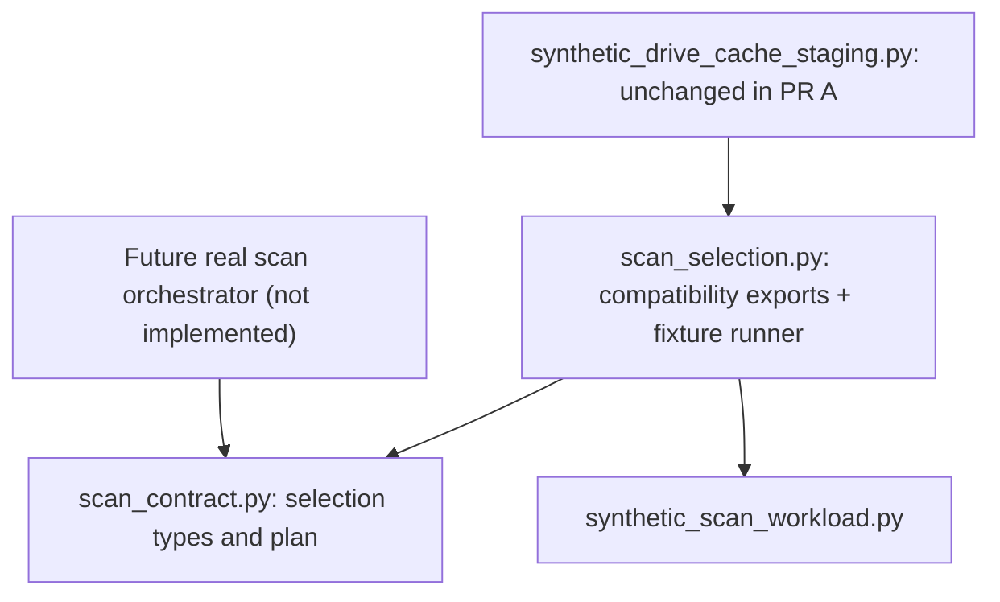

# P2.1 — Forex Module Boundary & Dependency Audit (DESIGN ONLY)
Date: 2026-11-07 | Status: P2.1-A AND P2.1-B REFACTOR MERGED #48 / #50 | Scope: audited baseline plus scoped independent code PR
Project: Forex Trading 1.0, private GitHub repo
Source reference: main 2a78ac532702ee543f064ccf7c57f9c4e941dc58
Original executable baseline: M2/P0.10 PR #28 7f0904eefad9afe3da7bbaab522d8c59b6847c9e
Canonical design: native 02_FOREX_MASTER_SPEC v0.11 §26; canonical governance: native 00_MASTER_HANDOFF v0.40 §50; QA §70 (original rollback audit §68 historical).
IMPORTANT: This proposal DOES NOT supersede any canonical document, and DOES NOT restore withdrawn M2/P0.11–P0.14 code.

## 1. Decision and scope
Approved direction: preserve Forex-specific domain and architecture; adopt strong engineering practices from Swing Trading only where genuinely compatible. Review module boundaries before changing Python behavior. This audit examines 10 named Forex source files plus three relevant test files, not the entire 46-file source/test tree. All findings below are scoped to the inspected files. No real FX feed, licensed storage, broker or Backtest is authorized.

## 2. Observed dependency edges on current main
| Module | Direct internal imports | Responsibility observed |
| --- | --- | --- |
| model.py | — | Direction, Horizon, ActionIntent, SignalStage, zone/signal domain types |
| quotes.py | model | UTC validation and BID/ASK indicative quote model |
| market_data.py | quotes | Observations, candle keys, first-known/revision/quality guards |
| source_qualification.py | market_data, quotes | Source capability/rights claims and read-only quality checks |
| cache_core.py | market_data, quotes | CachePartition, CandleSnapshot, delta plan/reconciliation |
| cache_storage_review.py | cache_core, quotes, source_qualification | Durable-store policy review and synthetic generation manifests |
| synthetic_scan_workload.py | cache_core, market_data, quotes | Synthetic 5-minute workload and stream reports |
| scan_selection.py | cache_core, quotes, synthetic_scan_workload | ScanMode/ScanSelection selection AND synthetic scan dispatch |
| synthetic_drive_cache_staging.py | cache_core, cache_storage_review, market_data, quotes, scan_selection | In-memory cache store AND mixed-scope fixture orchestration |
| synthetic_drive_receipt_validation.py | — | Offline validation of actual tiny Drive synthetic smoke receipts (no network calls) |

Observed shortest dependency chain:
- quotes -> model
- market_data -> quotes
- cache_core -> market_data + quotes
- synthetic_scan_workload -> cache_core
- scan_selection -> synthetic_scan_workload
- synthetic_drive_cache_staging -> scan_selection -> synthetic_scan_workload

### Focused import diagram (verified source edges)

### Target boundary after P2.1-A (implemented PR #48)

Note: arrows in this section mean "imports", not data flow. No cycle was observed among these inspected edges. There is no evidence here that all other modules are cycle-free.

## 3. Findings
**P2.1-F01 — Selection domain coupled to synthetic tests (target for first refactor).**
ScanMode, ScanSelection and plan_scan_selection are useful for both fixture testing and a future real scan orchestrator; however, their present home scan_selection.py also imports SyntheticScanFixture, SyntheticSweepReport and run_synthetic_five_minute_sweep. Consequently a future production component importing the public selection contract would transitively import synthetic workload code. This is an architectural dependency concern, not a confirmed bug or operational failure.

**P2.1-F02 — Synthetic storage mixed with orchestration (separate later refactor).**
SyntheticDriveCacheStaging handles in-memory chunk state and validation; the same module hosts run_mixed_scope_synthetic_drive_scan, which knows about selection and fixture sweep semantics. These responsibilities can be separated later. Do not combine F01/F02 in one change; preserve public imports and tests.

**P2.1-F03 — Current data-quality isolation is worth keeping.**
CandleSnapshot/CachePartition in cache_core.py enforce pair/provider/product/side/timeframe/version isolation, close/verified coverage and as-of constraints. MarketBar/Observation and source claims remain distinct; self-reported quality and head IDs do not grant real rights. Keep unchanged unless independently justified.

**P2.1-F04 — Existing Drive test boundary is explicit.**
synthetic_drive_receipt_validation.py validates copied synthetic files offline. It neither implements Google Drive authenticated persistence nor vendor rights/KMS/CAS/actual five-minute savings. Do not promote smoke validation to production storage.

## 4. PR A — selection contract isolation (IMPLEMENTED IN #48)
**New path (implemented separately in #48):** src/forex_trading/scan_contract.py
- Move unchanged ScanMode, ScanSelection and plan_scan_selection into scan_contract.py.
- Import only Python standard library modules in the new module; do not import synthetic workload, cache, vendor or broker dependencies.
- Retain scan_selection.py as a compatibility shim: re-export the same names, keep SelectedSyntheticScanReport and run_selected_synthetic_scan there.
- Leave synthetic_drive_cache_staging.py and existing imports unchanged for this PR. Preserve class identity through re-export, avoiding two competing enum/dataclass types.
- No changes to pair catalog rules or scope: SINGLE=1, CUSTOM=2..19, ALL=20 from caller-supplied catalog; fail closed on malformed/duplicate/unknown pairs.
- No change to external IO flags, source rights, BID/ASK side requirements, or fixture APIs.

**Acceptance for PR A:**
1. Old import paths still work and refer to the one canonical types/functions.
2. scan_contract.py has no import/path dependency on synthetic_scan_workload, cache_core, Google Drive or network/provider code.
3. Existing tests/test_scan_selection.py, tests/test_synthetic_drive_cache_staging.py and all repository tests remain passing.
4. New contract import/compatibility/corner-case tests, both Python 3.11 and 3.12; baseline is 448 existing tests per interpreter, not a forecast of the new total.
5. Identical results for SINGLE/CUSTOM/ALL, including 5→20→1→20 reuse and fail-closed incomplete BID/ASK; no change in external data requests (currently zero) or active snapshot data.
6. Compare new PR against M2/P0.10 source baseline: only approved new/relocated contract, compatibility imports and new tests may differ; no reintroduction of withdrawn PR #29–#37 code.
7. Run independent PR CI and postmerge main CI before claiming merged acceptance. Do NOT label this as complete merely because this design PR is merged.

**Rollback of PR A:** Revert only PR A via reviewed GitHub PR after confirming no downstream importers/new schema dependency. No changes to data, manifests, migrations, Drive objects, signal rules or approved business catalog are expected.

## 5. PR B — synthetic cache store/orchestrator split (IMPLEMENTED #50)
Only after PR A is verified: retain SyntheticDriveCacheStaging, SyntheticChunk and manifest validation in store module; relocate run_mixed_scope_synthetic_drive_scan and MixedScanResult to a synthetic-only orchestrator. Keep legacy imports as re-exports. Verify exact 5→20→1→20 fixture equivalence, stale writer/crash/quarantine behavior, and zero real IO. Must be its own independently reversible PR.

## 6. Non-goals and safety gates
- No implementation of segmented weekly cache, AES-GCM, real KMS, distributed CAS or off-host monotonic witness in P2.1.
- No live provider calls, true Drive raw-file storage adapter, scheduler, real trading, historical Backtest or OOS.
- No changes to active Master Spec v0.11, approved 18 labels (15 entry candidates), four LONG and SHORT display states, eight-stage pipeline, TP/Exit policy or 1/custom/20 scan modes.
- Design proposals are not substitute permissions for Forex-specific source retention/BID/ASK/cost data.
- FX repo only; no changes to Swing Trading, CK, FX 2.0, Scanner or Mac devices.
- This document was authored through docs-only PR #47. Implementation belongs exclusively to separately verified PR #48. Do not rewrite Git history or silently re-introduce withdrawn M2/P0.11–P0.14 features.

## 7. Completion criteria for P2.1 design review
- [x] Record observed module edges from current main and identify coupling with concrete paths.
- [x] Identify interfaces to preserve and propose the smallest reversible change.
- [x] Specify acceptance tests, non-goals and rollback boundary.
- [x] Review/accept this plan as a design artifact (user authorized continuation).
- [x] Implement PR A via independent feature PR #48 (merged e8cf43830fd6f7086f4366a43363d3eabb2d99f4).
- [x] Verify PR #48 Actions 42391199891: 454/454 tests PASS in Python 3.11 and 3.12 (448 previous + 6 new). Merge diff exactly 3 allowed source/test files. Postmerge main CI still requires independent readback.
- [x] PR B completed separately: source PR #50 merged 238de5454187c2312e885d45dbcae6107e25818f; 461/461 synthetic CI tests PASS per Python 3.11 and 3.12.

## 8. Implementation receipt (after approval to continue)
- User requested continuation in the single active Forex conversation. PR A #48 MERGED squash commit e8cf43830fd6f7086f4366a43363d3eabb2d99f4; source branch feature/p2-1-selection-contract-isolation.
- GitHub Actions PR run 42391199891 passed. Verified job logs: Python 3.11 Ran 454 tests OK; Python 3.12 Ran 454 tests OK.
- The code is a single new dependency-free selection module plus legacy re-export and six tests, not a restored cache/crypto/backtest milestone. No provider requests or Drive writes were performed by new code.
- The original M2/P0.10 commit 7f0904e remains the immutable historical rollback checkpoint. Current main is now an explicitly reviewed post-baseline P2.1 refactor; do not assert 47/47 original file parity remains TRUE for active main (three intentional differences).
- Postmerge main Actions result has not been independently checked via the current connector; do not claim it passed. Native Drive 00/06 documentation synchronization is separate and must preserve authoritative historical receipts. PR B is MERGED via reviewed PR #50; full evidence §9.

## 9. P2.1-B completion receipt (verified after source merge)

- Source change PR [#50](https://github.com/ngluonghoa/forex-trading-1-0/pull/50) MERGED squash SHA `238de5454187c2312e885d45dbcae6107e25818f`. Exact four paths: `src/forex_trading/synthetic_drive_cache_store.py` (new), `src/forex_trading/synthetic_drive_scan_orchestrator.py` (new), `src/forex_trading/synthetic_drive_cache_staging.py` (legacy compatibility shim), `tests/test_synthetic_cache_boundary.py` (7 new synthetic tests).
- Store module now has NO scan/orchestrator dependency. Orchestrator module depends on store and pure `scan_contract`. Legacy API names still re-export original canonical class/function objects by identity. All original `run_mixed_scope_synthetic_drive_scan` arguments, default timeframes, input guards and return fields preserved.
- Independently fetched pre-PR source and postmerge modules: original Action+Chunk block (394 chars), cache store class (5354), MixedScanResult (533), mixed-scope runner (4818) are exact matching source-text bodies. No algorithmic body edit, only module boundary/imports and added tests.
- [GitHub Actions PR run 42392919832](https://github.com/ngluonghoa/forex-trading-1-0/actions/runs/42392919832) completed SUCCESS. Independently fetched logs: Python 3.11 **Ran 461 tests OK**; Python 3.12 **Ran 461 tests OK** (existing 454 + 7). Fixture suite covers 5→20→1→20, source corrections, no cross-pair eviction, stale generation, crash orphan, damaged head/chunk, missing BID/ASK/TF fail-closed and absent real IO flags. Independent postmerge MAIN-push CI not separately verified; remain accurate about evidence.
- Original immutable historical M2/P0.10 source checkpoint `7f0904e` remains. From it to P2.1-B main, seven specific source/test paths intentionally differ (3 in PR #48 + 4 in PR #50). Withdrawn M2/P0.11–M2/P0.14 prototype code remains absent. No vendor data, authenticated Drive transport, real cache, broker, Backtest or release.
- Canonical governance on Drive: Handoff v0.40 §50; QA v0.55 §70; 02 Master Spec v0.11 §26 unchanged. Next work P2.2 is a data-contract architecture review only; new code requires separate scoped review/CI gates.
