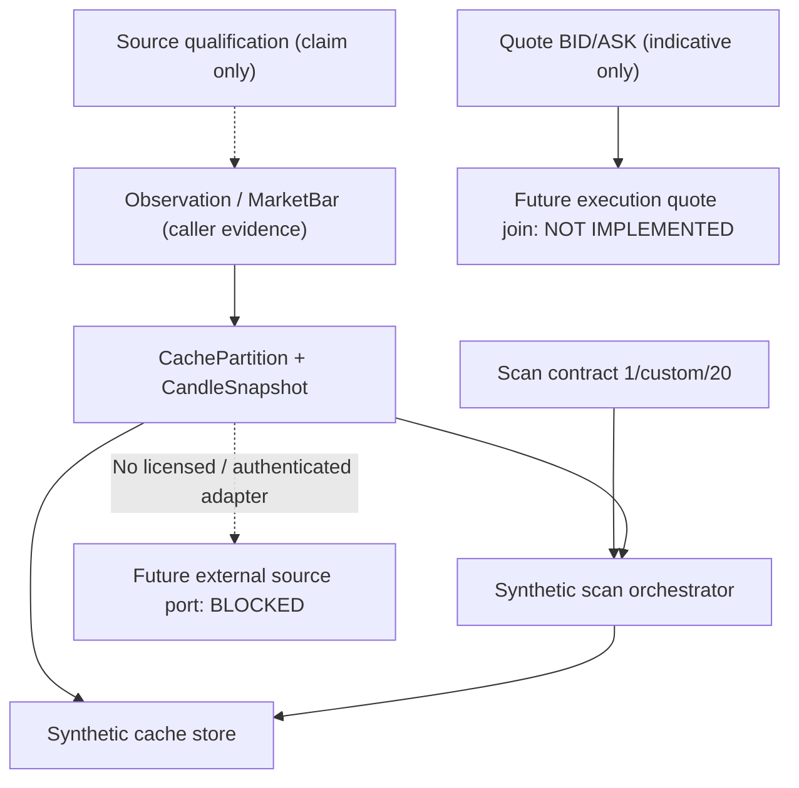

# P2.2 — Forex Data Contract & Interface Review

**Review date:** 2026-11-08 (Asia/Ho_Chi_Minh)  
**Status:** REVIEW COMPLETE / P2.2-A #54 + P2.2-B #56 IMPLEMENTED IN SEPARATE PRs — ORIGINAL PLANS HISTORICAL  
**GitHub baseline examined:** `main` `941e2ef775e03ef77b1ce76fed32a3e0a38f2959` (P2.1-A+B code and docs).  
**Canonical authority:** native `02_FOREX_MASTER_SPEC` v0.11 §26; `00_MASTER_HANDOFF` v0.40 §50; QA v0.55 §70, prior rollback QA §68.  
**Immutable historical rollback checkpoint:** `7f0904eefad9afe3da7bbaab522d8c59b6847c9e` (original M2/P0.10). It is not current HEAD.

This document is a static/contract review against current code, test names and the approved Master Spec. Findings identify **risk boundaries or missing interfaces**, not incidents on a running market-data service. The repository still has no authorized live quote/feed, external Drive persistence, executable detector, Backtest/OOS or broker execution. No Swing Trading source has been copied or modified.

## 1. Files inspected and existing strengths

Current Forex code examined:
- `src/forex_trading/model.py`, `quotes.py`, `market_data.py`, `source_qualification.py`
- `cache_core.py`, `cache_storage_review.py`, `scan_contract.py`
- `synthetic_drive_cache_store.py`, `synthetic_drive_scan_orchestrator.py`
- Existing test suites `test_quotes.py`, `test_market_data.py`, `test_cache_core.py`, `test_source_qualification.py`, `test_synthetic_scan_workload.py`, `test_synthetic_cache_boundary.py`.

Preserve all of the following:
1. Typed immutable `MarketBarKey`, `Observation`, `MarketBar`, `CachePartition`, `CandleSnapshot`, `SourceHeadClaim` and `Quote` contracts.
2. Non-crossed BID <= ASK quote guard; action prices: ENTRY_LONG at ASK, EXIT_LONG at BID, ENTRY_SHORT at BID, EXIT_SHORT at ASK. `indicative_price` never means an actual fill.
3. First-known/as-of and CLOSED/COMPLETE/quality checks; M15 baseline and conditional closed M5 trigger. MID is analysis-only, not an executable price side.
4. Source-rights claim separated from genuine vendor authorization; `assess_source_for_m2_review` and `assess_durable_cache_proposal` always refuse real-data authorization.
5. Cache partition separation by provider, broker product, instrument, BID/ASK side, timeframe, calendar, aggregation, timezone, rights policy reference and schema.
6. Bounded-overlap/append/revision planning and explicit uncertainty about corrections outside the overlap; no silent deletion; `source_claim_authenticated=False` and `may_fetch_real_data=False`.
7. Existing `SINGLE/CUSTOM/ALL` pair selection and synthetic `5→20→1→20` cache reuse, unchanged under P2.1 refactors.

## 2. Dependency / data-flow diagram

Arrows show conceptual data dependencies. The diagram is not evidence that a real source adapter or broker integration exists.

## 3. Findings, impact and candidate treatment

### P2.2-F01 — Stream/product provenance binding at cache boundary (HIGH)
**Observed:** `CachePartition` has provider, broker product, instrument, side, timeframe, calendar, aggregation, timezone, rights and schema, but does **not** have `stream_id`/endpoint. `_validate_bar` checks `observation.provider_id` and timezone policy against the partition but does not require a single consistent `observation.stream_id` across all bars in a `CandleSnapshot`. A snapshot containing different stream IDs with otherwise matching typed keys is therefore not explicitly rejected by that guard.

**Why it matters:** A future provider may change endpoint/stream/broker-product mapping during revisions. Different source streams must not silently become one homogeneous history.

**Proposal:** Add an *opt-in, read-only* typed `SourceStreamBinding` / `qualify_snapshot_binding` guard that explicitly binds provider, broker product, instrument version, side, timeframe, calendar policy, declared stream ID and verified product mapping. It must fail closed on conflicting streams or missing qualification, and must not manufacture a vendor entitlement or rely on an arbitrary stream ID alone as proof of authenticity. Do not mutate existing cache keys until the migration/retention consequences are reviewed.

### P2.2-F02 — Price-content digest vs complete provenance/lineage receipt (HIGH)
**Observed:** `CandleSnapshot.fingerprint` hashes a partition fingerprint plus `_bar_row`, which covers bar times, revision number, bar first-known, stream/revision ID, raw SHA256, OHLC and lifecycle/coverage/quality. The digest does **not** cover all `Observation` fields, such as endpoint, observation `retrieved_at_utc`, `license_scope_claim` or observation `first_known_utc`. This is a selective cache-content fingerprint, **not** a comprehensive provenance receipt.

**Why it matters:** A metadata-only change may not alter the snapshot fingerprint or create a new manifest generation. Conversely blindly adding every metadata field to the price digest would trigger unnecessary market-feature recomputation every time a retrieval timestamp changes.

**Proposal:** Explicitly separate **price-content hash** (indicator/structure dirty-check) from **provenance event/lineage hash** (source metadata, rights references and witnessed change receipt). On metadata-only changes, write only a bounded lineage event if authorized; do not redraw unchanged OHLC or invalidate L2–L5 without a genuine dependency change. A rights revocation must fail closed and trigger dedicated retention/erasure policy, not merely a new digest. Audit events and access grants are separate concepts.

### P2.2-F03 — BID/ASK temporal and broker-product pairing (HIGH)
**Observed:** `synthetic_drive_scan_orchestrator.py` enforces both BID and ASK for each expected timeframe and a matching `instrument_version`, but its preflight uses the set of `(timeframe,side)` pairs; it does not itself prove the two sides come from the same provider/product or from synchronized bar windows/quote instants. `Quote` records provider/revision/event/first-known/BID/ASK but has no instrument/broker-product field tying it to a `CachePartition`. `indicative_price` is deliberately just indicative.

**Why it matters:** Merely having a BID candle and an ASK candle does not establish an executable spread or a valid side-paired price for the same moment.

**Proposal:** Design `BidAskPairEvidence`/quote-to-partition join with explicit instrument, product/venue/contract, provider, timeframe, window/decision time, source revisions and as-of provenance. Reject mismatched product/source/time. Never manufacture spread from unrelated candle extrema or claim fills from OHLC.

### P2.2-F04 — Source-known clock vs locally observed/retrieved clock (HIGH)
**Observed:** `MarketBar.first_known_utc` is checked against observation `first_known_utc`, and `Observation.retrieved_at_utc` must not precede observation first-known. `select_asof_revision` and `evaluate_closed_bar` use bar-level `first_known_utc` as the causal cutoff; they do not directly validate an independently witnessed historical source-availability event. All current observation fields are caller-provided claims.

**Why it matters:** A backtest must not mistake a vendor-reported original event time or a retrospectively reconstructed timestamp for proof that a correction was available at a past decision point.

**Proposal:** Keep distinct `source_event_time`, `source_first_available`, `client_observed/retrieved`, `revision_first_known`, `bar_close`, and `decision_as_of`; define which is authoritative for live, paper, and historical replay. If availability cannot be independently established, return `UNVERIFIED` and prohibit historical signal scoring/production readiness. Test delayed/out-of-order provider revisions, retroactive corrections and DST boundaries.

### P2.2-F05 — Head claim is not a verified no-change cursor (HIGH, external blocker)
**Observed:** `plan_incremental_refresh` can return `REUSE_HEAD_CLAIM` from a matching caller-provided `SourceHeadClaim`. The `RefreshPlan` still records `source_claim_authenticated=False` and `may_fetch_real_data=False`. Existing tests explicitly show corrections outside the overlap can remain unseen.

**Proposal:** Future provider adapter may skip network history only on independently validated, vendor-specific coverage and revision semantics, with bounded head freshness and correction strategy; otherwise query overlap, schedule a qualifying full audit or mark unresolved. Never label simulated returned bar counts as real HTTP savings. No authenticated changed-since cursor is implemented.

### P2.2-F06 — FX timeframe, DST, rollover and tick-volume semantics (MEDIUM / gated)
**Observed:** `MarketBarKey` validates exact M1/M5/M15/M30 durations. H1/H4/D1/W1 depend on source-specific calendars and session/DST policy rather than an invented universal close. `MarketBar` has no tick-volume field; the approved spec distinguishes missing vs zero and source semantics.

**Proposal:** Future versioned, provider-specific calendar/aggregation evidence and *optional* `TickVolumeEvidence` with `NOT_REPORTED` distinct from numeric zero. Verify Sunday partial D1, New York rollover, holiday/weekend gaps, tick-volume comparability and aggregation changes. Do not silently add `volume=0` defaults or use Vietnamese equity matched-volume rules.

### P2.2-F07 — Selected-pair preflight vs multi-partition transactional commit (MEDIUM / storage blocker)
**Observed:** Mixed-scope synthetic scan preflights required pair/side/timeframe snapshots, then mutates the in-memory cache one partition at a time. Validation of the selected set is not an independent distributed all-or-nothing commit or Google Drive manifest CAS across partitions. Per-partition `stage_and_commit` uses only in-memory claimed optimistic concurrency.

**Proposal:** Keep deterministic per-partition updates and report partial/failed outcomes explicitly. A future real Drive port needs bounded staging, immutable chunks, validated per-partition commits, independent head witness/lease, restart recovery, retry and quarantine, plus source retention/erase gates. Do not promise atomic all-20 scan transactions without a measured and approved design.

### P2.2-F08 — Versioned interface evolution and unchanged business semantics (MEDIUM)
**Observed:** Domain primitives, source claims and synthetic cache types are separate, but there is not yet a single qualified adapter-to-signal/backtest contract capable of carrying source identity, consistent quote side, observed revision, as-of receipts and provenance/price digests through to execution logic.

**Proposal:** Introduce such boundaries *as additive, versioned read-only contracts* only once each acceptance gate is specified. Avoid changing approved zones/status priorities, TP/Exit, signal lifecycle or the legacy import paths in this review. No executable detector or trade-authority type belongs in a cache metadata DTO.

## 4. Concrete P2.2 implementation order (separate PRs, never all at once)

| PR gate | Purpose | Changes allowed | Must prove |
| --- | --- | --- | --- |
| **P2.2-A (FIRST)** | Add synthetic-only read-only stream/product binding guard | Additive contract module and tests; no schema migrations | reject mixed stream/product/side/TF, confirm legacy API parity and no source authorization |
| P2.2-B | Dual content vs provenance evidence definitions | Additive metadata-only evidence receipt + tests; optional integration only after review | lineage-only change does not rewrite stable OHLC/chunks or dirty L2–L5; revocation fail-closed |
| P2.2-C | Explicit BID/ASK & Quote identity/time join | Read-only joined evidence and negative tests | reject mismatched provider/product/bar window/decision as-of; no inferred fills |
| P2.2-D | Causal availability/revision-clock contract | Synthetic replay fixtures, witness interface design | no future knowledge, correction audit, DST and delayed revisions; ambiguity -> UNVERIFIED |
| P2.2-E | Provider-specific calendar/volume and batch recovery design | Design/tests first; schema only with approved migration | no zero-vs-missing confusion, no invented D1 close, crash/partial-commit transparency |

P2.2-A is **a proposal**, not started by this documentation PR. Each code PR requires independent reviewable diff, Python 3.11 and 3.12 CI, explicit rollback and readback of main after merge. Baseline before P2.2 is **461 existing tests per Python** (P2.1-B PR CI run 42392919832), not a claim about new tests or latest main push CI.

## 5. Mandatory negative-test matrix for future PRs

- Cross-provider / cross-broker-product / mixed stream ID contamination within one supposed history; missing or changed broker-product mapping.
- BID/ASK from different source, timeframe or bar window; MID erroneously offered for execution; crossed/zero quote; stale or mismatched as-of.
- First-known after decision; retrospective correction with falsely early event time; revision number duplicated/out-of-order; unknown historical availability.
- OHLC content unchanged but provenance metadata/retrieval time changes: no false L2–L5 dirty rewrite; maintain distinct append-only lineage.
- True OHLC correction within overlap invalidates from earliest dirty candle only; outside overlap cannot be silently certified clean.
- Vendor revocation/retention expiry results in fail-closed, not old cached-data reuse; unverified no-change cursor cannot authorize external IO.
- D1/weekly weekend/DST clock and tick volume NOT_REPORTED vs zero.
- Selected 5→20→1→20 scope, unavailable side/TF, missing/corrupt chunk, stale writer, preflight failure and crash/partial transaction receipt.
- All real `may_*` permissions remain **false** without separately verified source entitlement, host protections and release gates.

## 6. Decision / rollback / no-go

- **Keep:** all existing typed Forex contracts and original historical M2/P0.10 source checkpoint as an immutable rollback anchor; P2.1-A+B improvements remain active.
- **Improve now:** contract clarity and small additive read-only guards with unit/negative tests, beginning only after this review's accepted boundary.
- **Defer:** real provider adapters, actual Google Drive durable FX data, encryption/KMS, vendor authenticated revision heads, L2–L5 runtime, Backtest, OOS and broker trade execution pending independent rights/security/quality.
- **Do not apply:** Swing/HOSE/HNX/UPCoM sessions, matched volume, price bands, settlement and stock T+ semantics directly to Forex.
- **Rollback for docs PR:** revert the P2.2 document PR only; native business Master Spec and source code remain unchanged. For any future code PR, independently revert only that code PR, never reset history to a draft branch.
- **One-lane governance:** never concurrently mutate this Forex repo from multiple conversations, and do not treat historical §41–§47 NEXT or withdrawn M2/P0.11–0.14 prototypes as current.

**Review result:** P2.2 CONTRACT_GAP_REVIEW_COMPLETE; P2.2-A..E CODE_NOT_STARTED; REAL_DATA_RIGHTS_BACKTEST_AND_TRADING_BLOCKED.

## 7. Addendum — P2.2-A implementation receipt (2026-11-08)

**New latest checkpoint (supersedes earlier text in this design review calling A not started):** [Source PR #54](https://github.com/ngluonghoa/forex-trading-1-0/pull/54) MERGED to main squash `026e3defc661098eb5648f4f56b7afb92008721f` from base `ad147973f5aeb1004e293bc814b8df2645bd24e0`. Exactly two new paths: `src/forex_trading/source_stream_binding.py` (additive frozen `SourceStreamBinding`, `StreamBindingReview`, pure `qualify_snapshot_binding`) and `tests/test_source_stream_binding.py` (15 synthetic tests). No existing `CachePartition`, `MarketBar`, candle fingerprint, store, orchestrator, CI, requirements or business-spec modifications.

**Acceptance:** [GitHub Actions run 42395599590](https://github.com/ngluonghoa/forex-trading-1-0/actions/runs/42395599590) completed SUCCESS; independently fetched job logs show **476/476 tests PASS in Python 3.11** and **476/476 tests PASS in Python 3.12** (461 prior + 15 new). Cross-stream, endpoint, provider, broker product, rights-policy, schema, TF/side, causal retrieval and immutability negative tests are included. Independent postmerge main push CI was not verified.

**Safety:** Binding reference is *caller-declared*, not a vendor mapping attestation. `mapping_independently_verified`, `vendor_entitlement_independently_verified`, `may_ingest_real_data`, `may_persist_real_data`, and `may_trade` are always FALSE. An empty/no binding or a mismatched stream fails closed. Existing 5→20→1→20 cache tests unchanged, and no authenticated source calls, real Drive objects, or broker orders were added. The historical M2/P0.10 rollback reference `7f0904e` remains. P2.2-B (price-content vs provenance/lineage) is **NEXT / NOT STARTED**; P2.2-C..E remain deferred. Canonical native Handoff v0.42 §52 and QA v0.57 §72 provide the latest checkpoint.

## 8. Addendum — P2.2-B dual digest and lineage receipt (2026-11-08)

**Source PR #56** [Forex synthetic evidence lineage](https://github.com/ngluonghoa/forex-trading-1-0/pull/56) MERGED squash SHA `92729806442cdd6b2abe6287f8995d5b1a588b61` from base `260225a4cbdad9f30c238e49c82cafc56ed37e15`. Exactly two additive paths: `src/forex_trading/synthetic_evidence_lineage.py` and `tests/test_synthetic_evidence_lineage.py`. No existing source, cache storage schema, scan orchestrator, native 02 Master Spec or dependencies changed. The earlier section's P2.2-B "proposed/not started" is historical; this addendum is the latest status.

**New pure synthetic interface:** `price_content_digest` hashes partition + candle window/side/TF, normalized numeric Decimal OHLC, lifecycle/quality/coverage, while `provenance_digest` additionally hashes complete *caller-declared* Observation stream/endpoint/revision/raw hash/first-known/retrieval/licence claim and snapshot checked_at/head. `compare_synthetic_evidence` returns UNCHANGED / LINEAGE_ONLY / CAUSAL_REPLAY_REVIEW / PRICE_DIRTY / BLOCKED. It proposes no indicator recalculation/price chunk write for metadata-only changes, earliest dirty candle on actual valid price change, and independent causal replay review when first-known or revision changes despite identical OHLC. Source rights REVOKED/EXPIRED/DENIED always block reuse. P2.2-A binding rejects mismatched provider/product/stream/endpoint/licence claims. All live-data rights and trade permission flags remain false.

**Optional synthetic lineage fixture:** frozen `SyntheticLineageEvent` with SHA256 parent, generation and decision-time/clock checks, verified within a supplied complete in-memory chain. This is NOT authenticated provider provenance, persistent storage, external trusted witness, actual rollback security, production cache write, source licensing proof, historical Backtest or trading.

**CI and acceptance:** [GitHub Actions PR run 42397147771](https://github.com/ngluonghoa/forex-trading-1-0/actions/runs/42397147771) completed SUCCESS, independently inspected Python 3.11 and 3.12 logs **Ran 502 tests OK** in each (476 old + 26 new). Original M2/P0.10 `7f0904e` rollback remains immutable; cumulative source/test changes since it are 11 explicit approved files (7 P2.1 + 2 P2.2-A + 2 P2.2-B). No withdrawn M2/P0.11–14 prototypes restored. Postmerge main push CI not independently verified.

**Latest governance:** native 00 Handoff v0.43 §53, QA v0.58 §73, 02 Master Spec v0.11 §26 unchanged. **NEXT** independently scoped P2.2-C BID/ASK identity/product/temporal join; P2.2-D first-known availability, P2.2-E session/DST/tick-volume/recovery remain not started. Live vendor feed, real Drive FX cache, KMS/CAS, OOS and broker release blocked.
